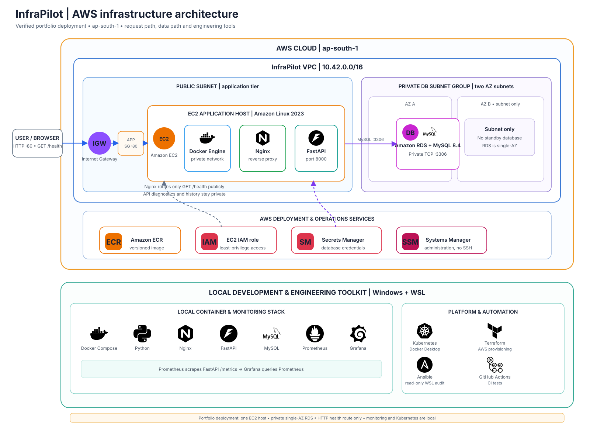
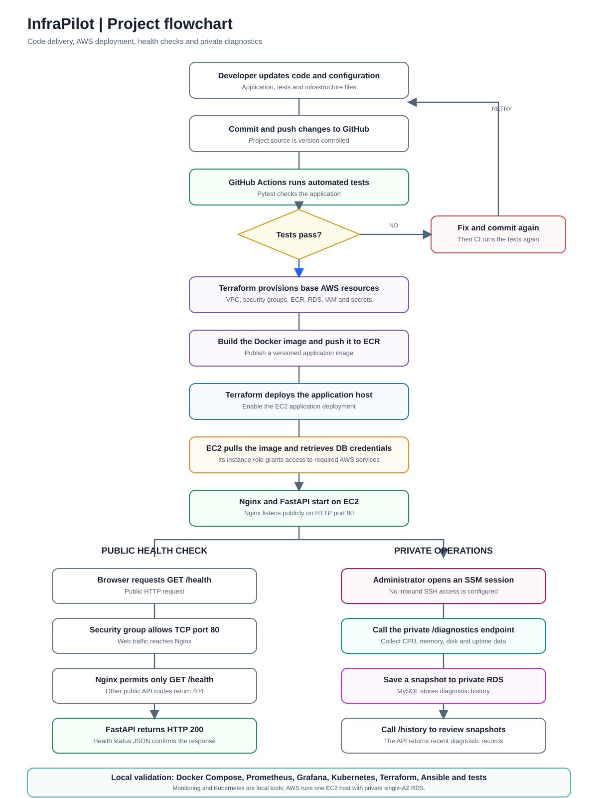

<div align="center">

# InfraPilot

### Infrastructure Diagnostics, Monitoring & AWS Deployment

<p>
  
  
  
  
  
  
  
  
  
  
  
  
  
  
</p>

**A hands-on infrastructure engineering project built, deployed, and verified locally and on AWS.**

[Live health check](http://13.233.198.93/health) · [AWS deployment guide](docs/AWS_DEPLOYMENT.md) · [Learning guide](docs/LEARNING_GUIDE.md)

</div>

> **Deployment scope:** InfraPilot is a portfolio-scale deployment in AWS `ap-south-1` using one EC2 host and a private, single-AZ RDS MySQL instance. Nginx exposes only `GET /health` over HTTP; all other API routes are not publicly routed. Prometheus, Grafana, and Kubernetes are local validation tools, not part of the AWS deployment. The EC2 public IP may change after a stop/start. This is a learning and portfolio environment, not a production-ready service.

## Project overview

InfraPilot is a FastAPI service for infrastructure health checks and host diagnostics. It collects CPU, memory, disk, and uptime signals; performs bounded TCP connectivity checks; exposes Prometheus metrics; and stores diagnostic snapshots. Local runs use SQLite. The AWS deployment uses private Amazon RDS for MySQL-backed diagnostic history.

The project brings application development and infrastructure operations together: Python API design, container packaging, reverse proxying, database connectivity, local Kubernetes, monitoring, Linux auditing, Terraform provisioning, and CI.

## What I built and verified

| Area | Implementation | Verified result |
|---|---|---|
| API | FastAPI health, diagnostics, history, database, network-check, and metrics routes | Health and diagnostics endpoints returned valid responses |
| Diagnostics | Read-only CPU, memory, disk, uptime, DNS, and bounded TCP checks | `/diagnostics` returned host signals; TCP check reached `example.com:443` |
| Persistence | SQLite locally; configurable MySQL backend for AWS | RDS MySQL 8.4.11 connection passed; a snapshot was written and returned by `/history` |
| Containers | Non-root API image, Docker Compose, and Nginx reverse proxy | Compose services started; health endpoint passed through Nginx |
| Kubernetes | Docker Desktop Deployment and Service | Two local API replicas rolled out and served `/health` |
| Monitoring | Prometheus scrape configuration and Grafana dashboard | Prometheus target was UP; CPU, memory, and disk panels displayed data |
| Infrastructure as code | Terraform for AWS VPC, subnets, security groups, EC2, RDS, ECR, IAM, and Secrets Manager | Terraform configuration validated and AWS resources applied |
| Linux automation | Read-only Ansible audit running against Ubuntu in WSL | Audit passed with `changed=0`, `failed=0` |
| Quality checks | Pytest and GitHub Actions | Six tests passed in WSL; GitHub Actions passed after the AWS bootstrap fix |

## Live AWS deployment

The current service is deployed in `ap-south-1` with:

- **Amazon EC2:** one Amazon Linux host running the API and Nginx containers.
- **Amazon ECR:** private container image repository; image tag `v1` was pushed successfully.
- **Amazon RDS for MySQL:** private, single-AZ database, version 8.4.11.
- **AWS Secrets Manager:** database credentials retrieved by the EC2 instance role.
- **AWS Systems Manager Session Manager:** administrative access without an inbound SSH rule.
- **Security boundary:** the public Nginx listener serves `/health`; a public request to `/diagnostics` returned `404`. Database and diagnostic checks were verified from an SSM session.

The live health endpoint returned `{"status":"ok","service":"infrapilot","version":"2.0.0"}`. From the instance, `/database-check` returned MySQL 8.4.11, `/diagnostics` wrote a snapshot, and `/history` returned the saved snapshots.

> The health link uses the current EC2 public IP. AWS may assign a different IP after the instance is stopped and started. Update the link from the current Terraform output or EC2 console if it changes.

## Architecture



*Editable source: [open the architecture in diagrams.net](docs/InfraPilot-Architecture.drawio).*

## Project flowchart

The flowchart shows the delivery and validation steps, the public health-check route, and the private operations path used for diagnostic snapshots and history.




Local development adds Docker Compose services for MySQL, Prometheus, and Grafana. Kubernetes was deployed to Docker Desktop; it is not an AWS EKS cluster.

## API routes

| Route | Purpose | Public AWS access |
|---|---|---|
| `GET /health` | Basic service health response | Yes |
| `GET /diagnostics` | Collect and save a diagnostic snapshot | No; verified from SSM |
| `GET /history` | Read recent snapshots | No; verified from SSM |
| `GET /database-check` | Check MySQL connectivity and version | No; verified from SSM |
| `GET /network-check?host=...&port=...` | Bounded TCP connectivity diagnostic | No |
| `GET /metrics` | Prometheus-format host metrics | No |

Interactive API documentation is available locally at `/docs` when running the application directly.

## Technology and skills demonstrated

<p>
  
  
  
  
  
  
  
  
</p>

- **Infrastructure engineering:** network segmentation, security groups, compute and database integration, infrastructure readiness, and operational validation.
- **Containers and orchestration:** Docker image creation, Compose service networking, Nginx proxying, Kubernetes Deployments, Services, and probes.
- **Cloud and automation:** Terraform plans and applies, IAM instance roles, ECR image publishing, Secrets Manager integration, SSM operations, and Ansible audits.
- **Monitoring and reliability:** Prometheus metrics, Grafana dashboards, health checks, service validation, and diagnostic history.
- **Software delivery:** API implementation, pytest, GitHub Actions CI, Git version control, and technical documentation.

## Run locally on Windows

Open PowerShell in the project folder. Python 3.12 and Git are required. Docker Desktop is needed for the container and Kubernetes sections.

```powershell
python -m venv .venv
.\.venv\Scripts\Activate.ps1
python -m pip install -r requirements.txt
python -m pytest -q
python -m uvicorn app.main:app --reload
```

In another PowerShell window, check the local API:

```powershell
Invoke-RestMethod http://127.0.0.1:8000/health
Invoke-RestMethod http://127.0.0.1:8000/diagnostics
Invoke-RestMethod http://127.0.0.1:8000/history
```

Stop the development server with **Ctrl+C**.

## Run the local container stack

Create a local environment file from the example, then start the base API and Nginx services:

```powershell
Copy-Item .env.example .env
docker compose up --build -d
docker compose ps
Invoke-RestMethod http://127.0.0.1:8090/health
```

Optional MySQL and monitoring profiles:

```powershell
docker compose --profile database --profile monitoring up --build -d
```

The local Nginx port is `8090`; Prometheus uses `9090`; Grafana uses `3001`. Ports can be changed in `compose.yaml` if another program already uses them. Local mode stores history in SQLite unless `INFRAPILOT_STORAGE_BACKEND=mysql` is selected.

## Kubernetes validation

The manifests were applied to the Docker Desktop cluster. To repeat the local rollout:

```powershell
docker build -t infrapilot:local .
kubectl apply -f k8s/
kubectl -n infrapilot rollout status deployment/infrapilot
kubectl -n infrapilot get pods,svc
kubectl -n infrapilot port-forward service/infrapilot 8001:8000
```

In a second terminal, check `http://127.0.0.1:8001/health`. Stop port forwarding with **Ctrl+C**. These are local Kubernetes resources, not an AWS-managed cluster.

## Repository map

```text
app/                 FastAPI routes, diagnostics, and storage backends
tests/               Pytest API and storage tests
terraform/           AWS network, EC2, RDS, ECR, IAM, and secret resources
ansible/             Read-only Linux infrastructure audit
k8s/                 Local Kubernetes Deployment and Service manifests
monitoring/           Prometheus scrape and Grafana datasource configuration
nginx/                Local reverse-proxy configuration
docs/                 Learning, operations, and AWS deployment guides
.github/workflows/    GitHub Actions test workflow
```

## Security and current limitations

- The AWS endpoint is **HTTP only** and is not suitable for sensitive user traffic.
- The AWS deployment has one EC2 host and a single-AZ RDS database; it has no high availability or disaster-recovery design.
- Only `/health` is exposed publicly. Keep diagnostic routes private unless authentication, authorization, and destination restrictions are added.
- AWS resources use credits and can incur ongoing costs. Check Billing, and stop or destroy resources when they are not needed. Review [AWS deployment and cleanup](docs/AWS_DEPLOYMENT.md).
- Terraform state and `terraform.tfvars` can contain sensitive information. Keep them private and out of Git.
- This project demonstrates infrastructure engineering practices and does not claim production readiness or compliance certification.

## Resume-ready project summary

> Built InfraPilot, a FastAPI infrastructure diagnostics service and deployed it to AWS using Terraform, Docker, EC2, ECR, and private RDS for MySQL-backed snapshot history. Added Nginx access controls, Systems Manager administration, Prometheus/Grafana monitoring, local Kubernetes manifests, a read-only Ansible audit, six automated tests, and GitHub Actions CI. Verified the public health endpoint and an end-to-end database snapshot write/read flow.

The AWS deployment is a single-server portfolio environment. Do not describe it as highly available or production-ready.
